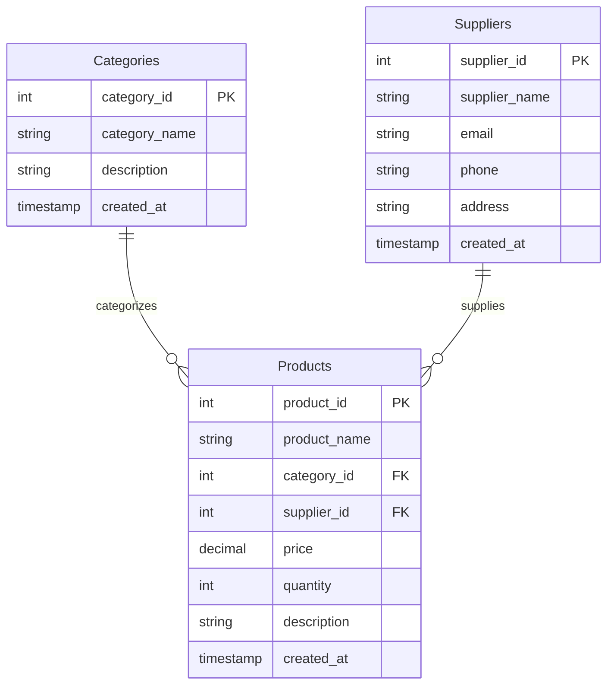

# Full-Stack Inventory Management System (FSD Lab Project)

A complete, production-ready, full-stack **Inventory Management System** built for a **Full Stack Development (FSD)** lab curriculum. Designed with a modern responsive frontend, robust REST APIs, and a relational MySQL database.

---

## 🌟 Technology Stack

| Layer | Technologies |
|---|---|
| **Frontend** | HTML5, CSS3, JavaScript (ES6+), Bootstrap 5.3, Bootstrap Icons |
| **Backend** | Node.js, Express.js, CORS, Dotenv |
| **Database** | MySQL (8.0+), `mysql2/promise` with Connection Pooling |
| **Architecture** | Client-Server Architecture / RESTful API / Single-Page Application (SPA) |

---

## 📁 Project Directory Structure

```text
inventory-management/
│
├── frontend/                     # Client-side presentation layer
│   ├── css/
│   │   └── style.css             # Modern dashboard styles, badges, and animations
│   ├── js/
│   │   ├── api.js                # Centralized REST API service with error handling
│   │   └── app.js                # UI state management, CRUD handlers, and rendering
│   └── index.html                # Responsive single-page dashboard interface
│
├── backend/                      # Server-side business logic & REST API
│   ├── config/
│   │   └── db.js                 # MySQL connection pool configuration (mysql2/promise)
│   ├── controllers/
│   │   ├── dashboardController.js# Dashboard statistics and low-stock calculations
│   │   ├── productController.js  # Product CRUD and stock adjustment logic
│   │   ├── categoryController.js # Category CRUD and product count logic
│   │   └── supplierController.js # Supplier CRUD and supply chain tracking
│   ├── middleware/
│   │   ├── errorHandler.js       # Centralized error handler and 404 handler
│   │   └── validator.js          # Request payload validation middleware
│   ├── routes/
│   │   ├── dashboardRoutes.js    # Routes for /api/dashboard
│   │   ├── productRoutes.js      # Routes for /api/products
│   │   ├── categoryRoutes.js     # Routes for /api/categories
│   │   └── supplierRoutes.js     # Routes for /api/suppliers
│   ├── scripts/
│   │   └── initDb.js             # Automated database creation and seeding script
│   ├── .env                      # Active environment configuration
│   ├── .env.example              # Sample environment template
│   ├── package.json              # Node dependencies and npm scripts
│   └── server.js                 # Express application entry point & static server
│
├── database/                     # Relational database scripts
│   └── schema.sql                # Complete schema DDL and realistic seed data
│
├── .gitignore                    # Git ignore file for node_modules and .env
└── README.md                     # Comprehensive project documentation
```

---

## 🗄️ Relational Database Schema

The database consists of **three related tables** with foreign key constraints and performance indexes.

### 1. `Categories` Table
Stores product taxonomy and organization categories.
* `category_id` (INT, Primary Key, AUTO_INCREMENT)
* `category_name` (VARCHAR(100), UNIQUE, NOT NULL)
* `description` (TEXT)
* `created_at` (TIMESTAMP, DEFAULT CURRENT_TIMESTAMP)

### 2. `Suppliers` Table
Stores vendor contact details and supply chain partners.
* `supplier_id` (INT, Primary Key, AUTO_INCREMENT)
* `supplier_name` (VARCHAR(150), NOT NULL)
* `email` (VARCHAR(150), NOT NULL)
* `phone` (VARCHAR(30), NOT NULL)
* `address` (TEXT)
* `created_at` (TIMESTAMP, DEFAULT CURRENT_TIMESTAMP)

### 3. `Products` Table
Stores individual inventory items and links to categories and suppliers.
* `product_id` (INT, Primary Key, AUTO_INCREMENT)
* `product_name` (VARCHAR(200), NOT NULL)
* `category_id` (INT, Foreign Key -> `Categories.category_id`, ON DELETE SET NULL)
* `supplier_id` (INT, Foreign Key -> `Suppliers.supplier_id`, ON DELETE SET NULL)
* `price` (DECIMAL(10, 2), NOT NULL, DEFAULT 0.00)
* `quantity` (INT, NOT NULL, DEFAULT 0)
* `description` (TEXT)
* `created_at` (TIMESTAMP, DEFAULT CURRENT_TIMESTAMP)



---

## 🚀 Setup & Installation Guide

### Prerequisites
* **Node.js** (v16 or higher)
* **MySQL Server** (8.0+ or XAMPP / WAMP / MariaDB) running on `localhost:3306`

---

### Step 1: Install Backend Dependencies
Open a terminal in the project directory and run:

```bash
cd backend
npm install
```

---

### Step 2: Configure Environment Variables
Verify or edit `backend/.env` with your MySQL credentials:

```ini
PORT=5000
NODE_ENV=development

DB_HOST=localhost
DB_PORT=3306
DB_USER=root
DB_PASSWORD=your_mysql_password_here
DB_NAME=inventory_management
```

> **Note**: If your local MySQL `root` user has no password (common in XAMPP or default local setups), leave `DB_PASSWORD=` blank.

---

### Step 3: Initialize Database & Seed Data (`database/inventory.sql`)

You have **two easy options** to set up the database:

#### Option A: One-Command Automated Setup (Node.js)
From the `backend` folder, execute:

```bash
npm run init-db
```
*This script connects to your MySQL server, executes `database/inventory.sql`, creates the `inventory_management` database, builds all tables (`Categories`, `Suppliers`, `Products`), sets up foreign keys, and inserts sample records.*

#### Option B: Execute in MySQL Workbench (Step-by-Step)
1. Open **MySQL Workbench** on your machine.
2. Click on your local MySQL connection (e.g. `Local instance MySQL80` or `localhost:3306`) and enter your password.
3. In the top menu, go to **File** -> **Open SQL Script...** (or press `Ctrl + Shift + O`).
4. Browse to your project folder and select `database/inventory.sql`.
5. The complete script will open in a query tab.
6. Click the ⚡ **Execute** button (the yellow lightning bolt icon in the query toolbar, or press `Ctrl + Shift + Enter`).
7. In the bottom **Action Output** panel, you will see green checkmarks for:
   - `CREATE DATABASE IF NOT EXISTS inventory_management`
   - `CREATE TABLE Categories`
   - `CREATE TABLE Suppliers`
   - `CREATE TABLE Products`
   - `INSERT INTO Categories...`, `Suppliers...`, `Products...`
8. In the left **Navigator** pane under **Schemas**, right-click and choose **Refresh All**. You will now see `inventory_management` with all three tables!

---

### Step 4: Verify Database Connection & CRUD Operations
Run the automated database test suite:

```bash
cd backend
npm run test-db
```
This script will test:
1. MySQL connection via `mysql2` pool using `.env` variables.
2. Table integrity (`Categories`, `Suppliers`, `Products`).
3. **[CREATE]** inserting new records with primary and foreign keys.
4. **[READ]** joined queries across products, categories, and suppliers.
5. **[UPDATE]** editing prices and inventory quantities.
6. **[DELETE]** safely deleting records.

---

### Step 4: Start the Server

```bash
npm start
```
*For development mode with automatic reload on code changes:*
```bash
npm run dev
```

Upon successful startup, the console displays:
```text
====================================================
🚀 Inventory Management Server is live!
🌐 Web Dashboard: http://localhost:5000
📡 REST API Base: http://localhost:5000/api
🩺 Health Check:  http://localhost:5000/api/health
====================================================
```

---

### Step 5: Open the Application
You can access the full system in two ways:
1. **Via Express Server (Unified)**: Visit **[http://localhost:5000](http://localhost:5000)** in any web browser.
2. **Via Local File or Live Server**: Open `frontend/index.html` directly or launch with VS Code Live Server. The frontend automatically connects to the backend API at `http://localhost:5000/api`.

---

## 📡 REST API Reference

All API responses are formatted in structured JSON:
`{ success: true, data: ..., message: "..." }`

### 1. Dashboard Statistics
| Method | Endpoint | Description |
|---|---|---|
| `GET` | `/api/dashboard/stats` | Returns total counts (products, categories, suppliers, stock units), valuation, and breakdowns |
| `GET` | `/api/dashboard/low-stock` | Returns products with quantity ≤ 5 (customizable via `?threshold=X`) |

### 2. Products API
| Method | Endpoint | Query / Body | Description |
|---|---|---|---|
| `GET` | `/api/products` | `?search=term&category_id=X&supplier_id=Y&stock_status=low\|out\|in&sort_by=name\|price\|quantity` | Get all products with filters & sorting |
| `GET` | `/api/products/:id` | None | Get single product by ID (includes joined Category & Supplier data) |
| `POST` | `/api/products` | JSON `{ product_name, category_id, supplier_id, price, quantity, description }` | Create new product |
| `PUT` | `/api/products/:id` | JSON `{ product_name, category_id, supplier_id, price, quantity, description }` | Update existing product |
| `DELETE` | `/api/products/:id` | None | Delete product |
| `PATCH` | `/api/products/:id/stock` | JSON `{ adjustment_type: "add"\|"subtract"\|"set", amount: 10, reason: "Restock" }` | Quick stock adjustment |

### 3. Categories API
| Method | Endpoint | Query / Body | Description |
|---|---|---|---|
| `GET` | `/api/categories` | `?search=keyword` | Get all categories with product counts and items in stock |
| `GET` | `/api/categories/:id` | None | Get category by ID with associated products list |
| `POST` | `/api/categories` | JSON `{ category_name, description }` | Create category |
| `PUT` | `/api/categories/:id` | JSON `{ category_name, description }` | Update category |
| `DELETE` | `/api/categories/:id` | None | Delete category |

### 4. Suppliers API
| Method | Endpoint | Query / Body | Description |
|---|---|---|---|
| `GET` | `/api/suppliers` | `?search=keyword` | Get all suppliers with total products supplied count |
| `GET` | `/api/suppliers/:id` | None | Get supplier by ID with supplied products list |
| `POST` | `/api/suppliers` | JSON `{ supplier_name, email, phone, address }` | Create supplier |
| `PUT` | `/api/suppliers/:id` | JSON `{ supplier_name, email, phone, address }` | Update supplier |
| `DELETE` | `/api/suppliers/:id` | None | Delete supplier |

---

## ✨ Features Walkthrough

### 1. Dynamic Responsive Dashboard
* **Real-time KPI Cards**: Instantly view Total Products, Total Categories, Total Suppliers, Total Stock Units, Inventory Valuation ($), and Low-Stock warnings.
* **Low-Stock Alert Banner**: Prominently highlights items needing reordering with a 1-click shortcut to restock.
* **Category Breakdown**: Visual progress bars showing percentage share of products across categories.
* **Recent Activity**: Quick snapshot of latest products added to inventory.

### 2. Products Management
* **Full CRUD**: Add, View Detailed Specifications, Edit, and Delete products with modal dialogs.
* **Live Search**: Instant keyword search on product name and description.
* **Multi-Filter Toolbar**: Filter by Category, Supplier, Stock Level (In Stock, Low Stock, Out of Stock), and Sort by ID, Name, Price, or Quantity.
* **Dynamic Stock Badges**: Color-coded badges (`In Stock` - green, `Low Stock` - animated amber, `Out of Stock` - red).

### 3. Categories Management
* Manage product classifications with real-time product counts.
* One-click filter to view all products under any specific category.

### 4. Suppliers Management
* Manage vendor contact details (email, phone, address).
* Direct `mailto:` and `tel:` links to communicate with suppliers.
* Track how many products each supplier provides.

### 5. Stock Management & Rapid Reorder
* Dedicated stock workspace to quickly adjust inventory.
* One-click quick adjustment buttons: `+1`, `+5`, `+10`, `-1`.
* Custom adjustment modal allowing `Add (Restock)`, `Deduct (Sale/Damage)`, or `Set Exact Quantity` with audit notes.

---

## 🎓 Lab Viva & Evaluation Questions

1. **Why use MySQL connection pooling (`createPool`) instead of `createConnection`?**
   * *Answer*: A connection pool manages multiple reusable database connections. Instead of opening and tearing down a TCP handshake for every HTTP request, connections are fetched from the pool and released back, significantly increasing concurrency and performance.
2. **How does the system ensure relational integrity when a Category or Supplier is deleted?**
   * *Answer*: The database uses `ON DELETE SET NULL` constraints on `category_id` and `supplier_id` in the `Products` table. If a category is removed, the products remain intact in the database with `NULL` category rather than causing orphan errors or unexpected cascading data loss.
3. **How does the frontend communicate with the backend?**
   * *Answer*: The frontend uses asynchronous JavaScript `fetch()` through a dedicated `ApiService` class (`frontend/js/api.js`). It handles JSON serialization, error status codes, network retry banners, and debounced search requests.
